# Foodie — Restaurant Ordering Platform

Three Flutter apps on one Neon-backed API — **not** a standalone Flutter-only app:

- **[Customer app](#customer-app)** — browse, order and track (Flutter, repo root).
- **[Admin app](#admin-app)** — restaurants, menus, prices, orders and analytics (`admin/`).
- **[Kitchen app](#kitchen-app)** — live order board, prep timers and item availability (`kitchen/`).
- **API** — Hono on Node, Drizzle ORM over Neon Postgres, Neon Realtime over SSE and
  S3-compatible Neon Object Storage for dish photos (`server/`).

All three apps talk to the same API, so a menu edit in admin or a sold-out toggle in
kitchen reaches the customer app without a rebuild. The customer app keeps bundled
demo data as an offline fallback.

## Architecture

| Piece | Located in | Stack | Backend surface it uses |
| --- | --- | --- | --- |
| Customer app | repo root (`lib/`) | Flutter, Material 3 | `GET /restaurants`, `GET /menu`, SSE `/events`, `POST /orders` |
| Admin app | `admin/` | Flutter + `fl_chart` | restaurants, menu, images, orders, analytics |
| Kitchen app | `kitchen/` | Flutter | order board, status writes, item availability |
| Shared Dart package | `packages/foodie_core/` | Dart + `http` | models and API client used by admin and kitchen |
| API | `server/` | Hono on Node, Drizzle ORM, Zod | Neon Postgres, Neon Realtime, S3-compatible object storage |

The API lives in `server/src/`:

- `routes/restaurants.ts`, `routes/menu.ts` — catalogue reads and writes.
- `routes/orders.ts` — order placement, status transitions, kitchen board.
- `routes/analytics.ts` — revenue, AOV, peak hours and area breakdowns.
- `routes/images.ts` — presigned uploads and a read-through proxy for dish photos.
- `routes/auth.ts` — demo admin/kitchen credentials.
- `realtime.ts` — Neon Realtime subscription; `GET /events` streams changes to
  every connected app over SSE.

## Showcase site

A Next.js showcase lives in [`web/showcase/`](web/showcase/). It presents the three apps, eight selected screens, the architecture and the 30-second tour, with an all-screens route at `/screens`.

```bash
cd web/showcase
npm install
npm run dev -- -p 3000
```

<table align="center">
  <tr>
    <td align="center" width="33%">
      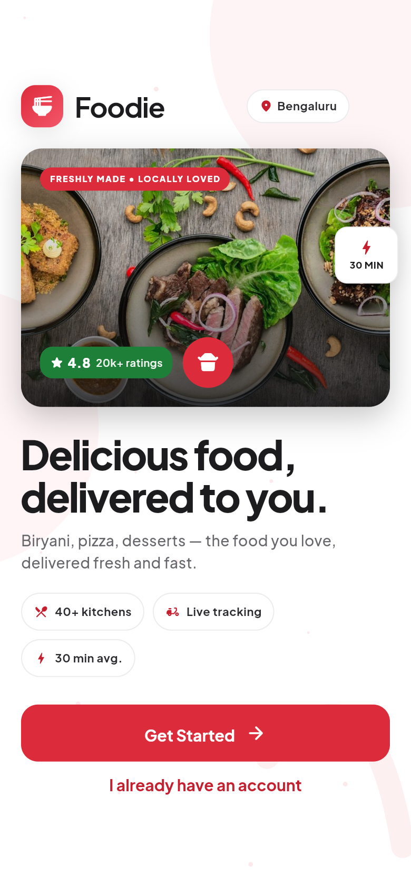
      <br /><sub><b>Welcome</b></sub>
    </td>
    <td align="center" width="33%">
      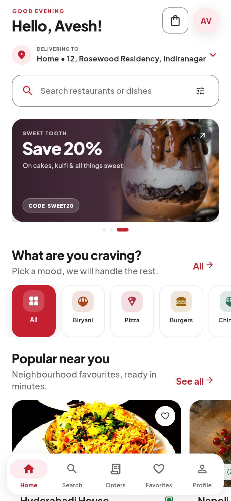
      <br /><sub><b>Home</b></sub>
    </td>
    <td align="center" width="33%">
      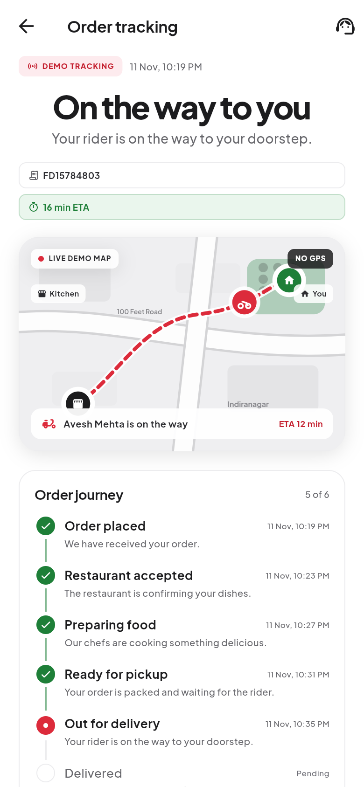
      <br /><sub><b>Live tracking</b></sub>
    </td>
  </tr>
</table>

## Customer app

> **Design direction:** warm red-on-white palette — `#E23744`-family
> red for every action, near-black ink, green star rating badges and an
> all-sans (Plus Jakarta Sans) type scale. Rounded cards, food photography
> bundled locally, light neutral shadows, small purposeful motion. A matching
> red-on-black dark theme is one tap away in Settings.

## Highlights

- **Material 3 UI** throughout: `NavigationBar`, tablet `NavigationRail`, `SegmentedButton`, Cards, `ListTile`, chips, switches, dialogs, bottom sheets and Material buttons.
- **Splash / welcome** with animated logo, tagline and Get Started CTA.
- **Mock login** that accepts any non-empty name, phone number or email and personalises the app instantly.
- **Home** with delivery address selector, search, auto-rotating offer carousel, category filtering, popular restaurants, recommended dishes and coupon offers.
- **6 restaurants and 28 dishes** with full menus, ratings, descriptions, veg / non-veg filters and add-ons.
- **Live search** across restaurants and dishes, recent searches, category filters and empty states.
- **Favorites** for both restaurants and dishes, synchronised across every screen.
- **Cart** with quantity controls, item removal, cooking instructions, coupon validation, GST, delivery fee and a correct live bill.
- **Checkout** with saved addresses, add / edit address sheets, simulated COD / UPI / card payments and order placement.
- **Order success** with confetti, a celebratory haptic pattern and the device's system alert sound.
- **Active orders**, **order history**, **reorder** and a six-step delivery timeline with animated status changes.
- **Demo tracking** with a hand-painted neighbourhood map, animated rider marker, mock rider details and ETA.
- **Simulated status controls** — advance manually or auto-play every 6 seconds. Fully labelled as demo.
- **Profile** with editable name/contact, saved addresses, orders, favorites, offers, support, settings and logout.
- **Support** with an FAQ accordion, quick topics and a local simulated chat assistant.
- **Responsive layouts**, SafeArea support, keyboard-aware forms, accessible 44 px tap targets and graceful image fallbacks.

Restaurants, menus, item availability and placed orders come from the API. Cart,
favorites, addresses and the session are held in memory and reset when the app
restarts or you log out. If the API is unreachable the app says so and falls back
to the bundled demo catalogue.

## Admin app

A separate Flutter admin app lives in `admin/` and talks to the Neon-backed
Hono API in `server/`. It is intentionally separate from the customer app.

- Sign in with `admin` / `password123` (demo only).
- Manage restaurants, menus, prices, and dish photos.
- Upload photos through the API to Neon Object Storage (with a relay fallback
  for networks that cannot resolve the storage host).
- Review orders and change status.
- View analytics: revenue, orders, AOV, returns, peak hours, weekdays, monthly
  revenue, restaurant revenue, and orders by area.
- Admin writes publish through Neon Realtime; the API streams changes to the
  customer app over SSE.

<table align="center">
  <tr>
    <td align="center" width="33%">
      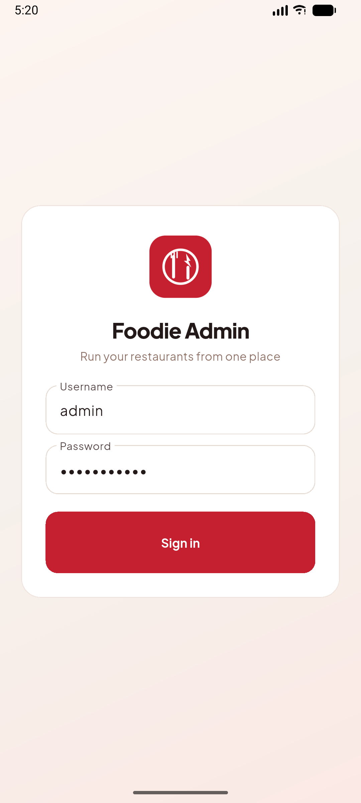
      <br /><sub><b>Admin login</b></sub>
    </td>
    <td align="center" width="33%">
      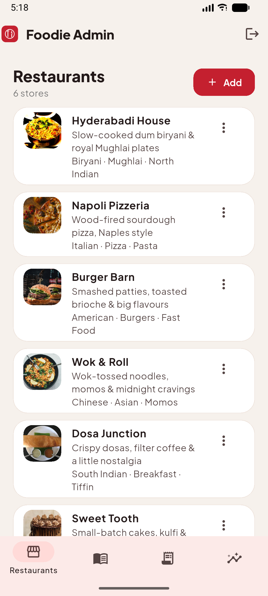
      <br /><sub><b>Restaurants</b></sub>
    </td>
    <td align="center" width="33%">
      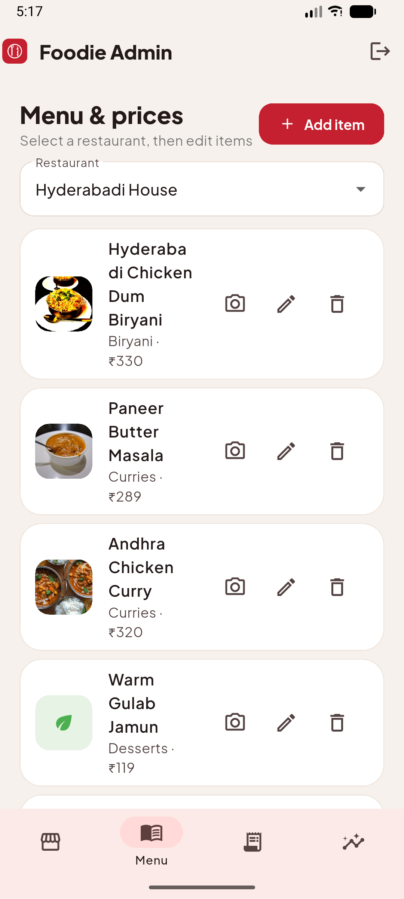
      <br /><sub><b>Menu &amp; prices</b></sub>
    </td>
  </tr>
  <tr>
    <td align="center" width="33%">
      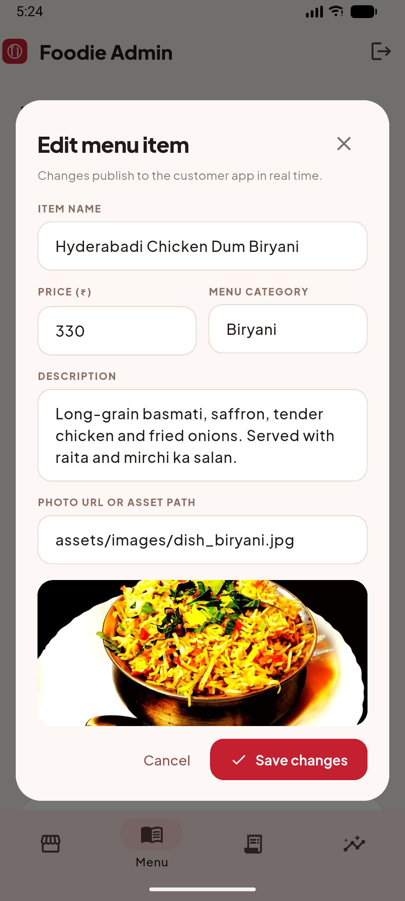
      <br /><sub><b>Edit menu item</b></sub>
    </td>
    <td align="center" width="33%">
      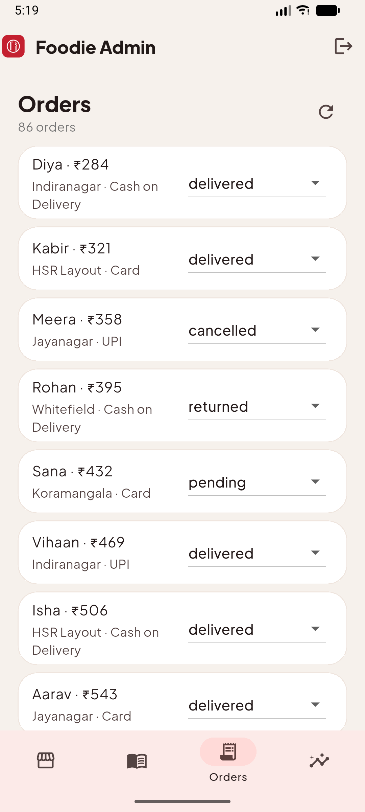
      <br /><sub><b>Orders</b></sub>
    </td>
    <td align="center" width="33%">
      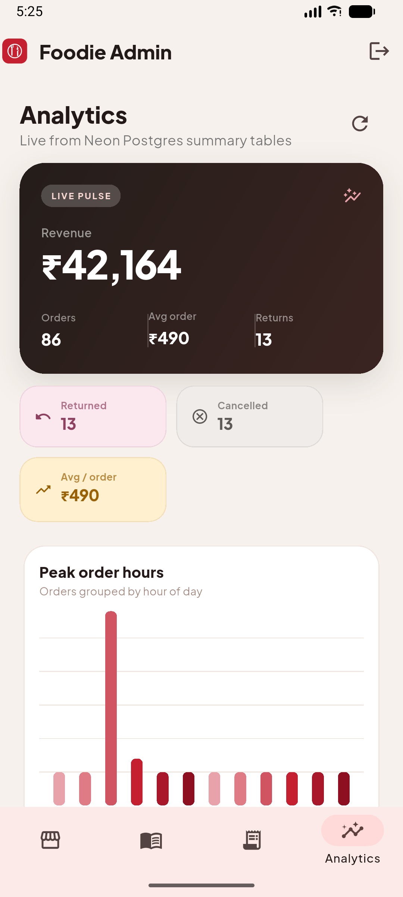
      <br /><sub><b>Analytics</b></sub>
    </td>
  </tr>
</table>

<table align="center">
  <tr>
    <td align="center" width="50%">
      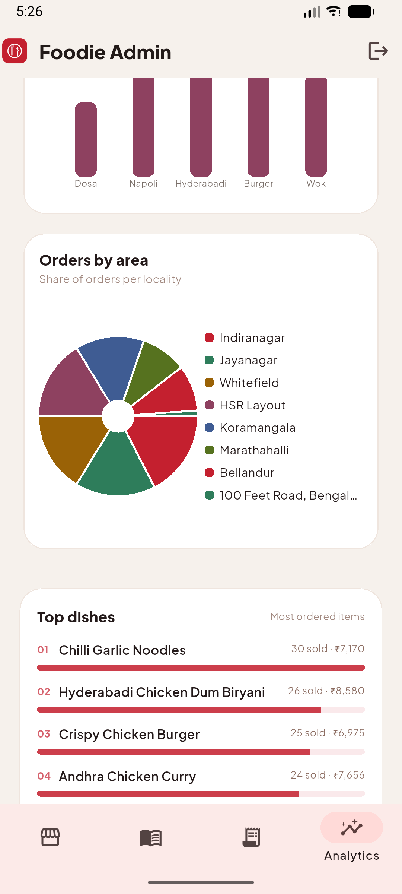
      <br /><sub><b>Charts</b></sub>
    </td>
  </tr>
</table>

### Run the admin app

```bash
# API
cd server
npm install
npm run db:seed
npm run db:seed:orders
npm run dev

# Admin Flutter app
cd admin
flutter pub get
flutter run
```

## Kitchen app

A separate Flutter kitchen app lives in `kitchen/` and uses the same Neon-backed
Hono API. It is intentionally separate from the customer and admin apps.

- Sign in with `kitchen` / `password123` (demo only). The account is bound to a
  single restaurant at seed time.
- View the restaurant's orders on a live Kanban board: Confirmed, Preparing, Ready.
- Live prep-time timer per order with green/amber/red thresholds.
- Move orders forward: Start cooking (confirmed→preparing), Mark ready (preparing→ready).
- Toggle item availability (in stock / sold out); changes broadcast to customer
  and admin apps through Neon Realtime.
- Sound + vibration alert on new orders.
- Offline error screen with retry.

Admin writes and kitchen writes publish through Neon Realtime; the API streams
changes to all apps over SSE.

<table align="center">
  <tr>
    <td align="center" width="33%">
      
      <br /><sub><b>Kitchen login</b></sub>
    </td>
    <td align="center" width="33%">
      
      <br /><sub><b>Orders board</b></sub>
    </td>
    <td align="center" width="33%">
      
      <br /><sub><b>Item availability</b></sub>
    </td>
  </tr>
</table>

### Run the kitchen app

```bash
# (API must be running, see above)

cd kitchen
flutter pub get
flutter run
```

### Run the customer app

The customer app reads its catalogue from the API (`http://localhost:3001` on web,
`http://10.0.2.2:3001` on the Android emulator) and posts orders to it. Start the
API first, then run the app:

```bash
flutter pub get
flutter run
```

Override the API host for a physical device or a deployed API:

```bash
flutter run --dart-define=API_BASE_URL=https://your-api.example.com
```

With no reachable API the app opens a connection screen offering **Try again** and
**Continue with saved menu**.

## API (`server/`)

The backend is a TypeScript Hono app served by Node, with Drizzle ORM over Neon
Postgres, Neon Realtime for change fan-out and S3-compatible Neon Object Storage for
dish photos.

`server/.env` supplies:

```text
DATABASE_URL              # Neon pooled connection
DATABASE_URL_UNPOOLED     # direct connection for schema push and seed
NEON_REALTIME_URL         # wss://... Neon Realtime endpoint
AWS_ENDPOINT_URL_S3       # Neon Object Storage endpoint
```

```bash
cd server
npm install
npm run db:push          # apply the Drizzle schema
npm run db:seed          # restaurants, menus, coupons, demo users
npm run db:seed:orders   # sample orders for analytics
npm run dev              # http://localhost:3001
```

| Method | Path | Purpose |
| --- | --- | --- |
| `GET` | `/health` | Liveness check |
| `GET`/`POST`/`PUT`/`DELETE` | `/restaurants`, `/restaurants/:id` | Restaurant catalogue |
| `GET`/`POST`/`PUT`/`DELETE` | `/menu`, `/menu/:id` | Menu items, prices, availability |
| `GET`/`POST`/`PUT` | `/orders`, `/orders/:id/status` | Order placement and kitchen status writes |
| `GET` | `/analytics/*` | Overview, by-area, by-restaurant, top dishes, peak hours, weekdays, month, prep time, daily summary |
| `POST` | `/images/presign` | Presigned PUT URL for an admin photo upload |
| `POST` | `/images/upload` | Base64 relay upload when the storage host is unreachable |
| `GET` | `/images/object?key=` | Public read-through proxy for a stored photo |
| `POST` | `/auth/login` | Demo admin and kitchen sign-in |
| `GET` | `/auth/me` | Current session |
| `GET` | `/events` | SSE stream of Neon Realtime changes consumed by all three apps |

## Screenshots

Every screen below is captured from this build at a 390 × 844 phone viewport. The app ships with both the light Foodie-inspired theme and the red-on-black dark theme. Click any image to open it full size.

### Ordering flow

<table>
  <tr>
    <td align="center" width="33%">
      <a href="docs/screenshots/restaurant.png">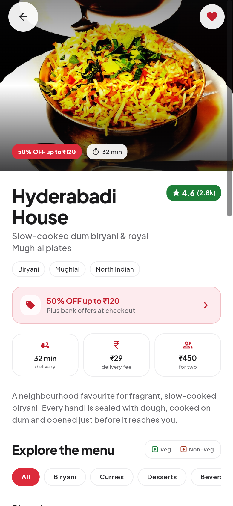</a>
      <br /><sub><b>Restaurant</b></sub>
    </td>
    <td align="center" width="33%">
      <a href="docs/screenshots/menu.png">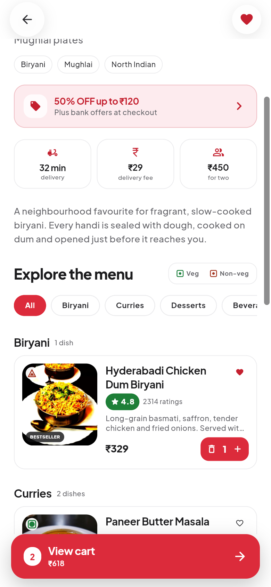</a>
      <br /><sub><b>Menu &amp; cart bar</b></sub>
    </td>
    <td align="center" width="33%">
      <a href="docs/screenshots/dish-customisation.png">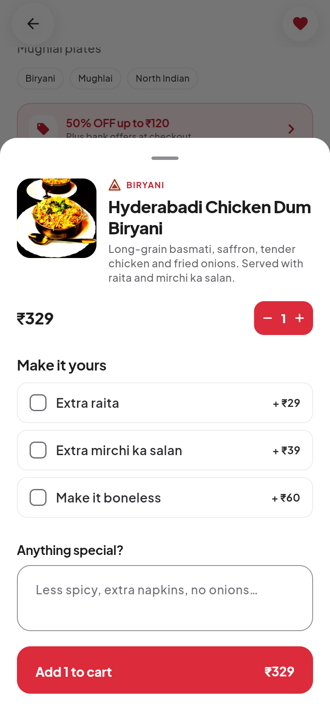</a>
      <br /><sub><b>Dish customisation</b></sub>
    </td>
  </tr>
  <tr>
    <td align="center" width="33%">
      <a href="docs/screenshots/cart.png">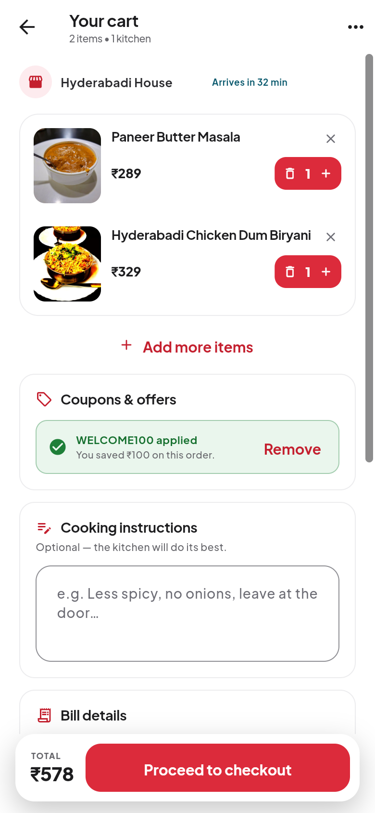</a>
      <br /><sub><b>Cart &amp; coupons</b></sub>
    </td>
    <td align="center" width="33%">
      <a href="docs/screenshots/checkout.png">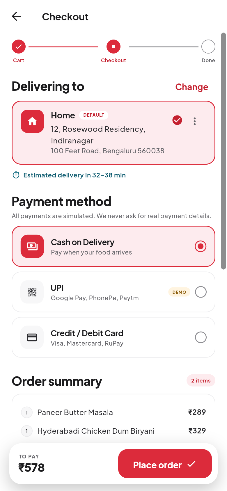</a>
      <br /><sub><b>Checkout</b></sub>
    </td>
    <td align="center" width="33%">
      <a href="docs/screenshots/order-success.png">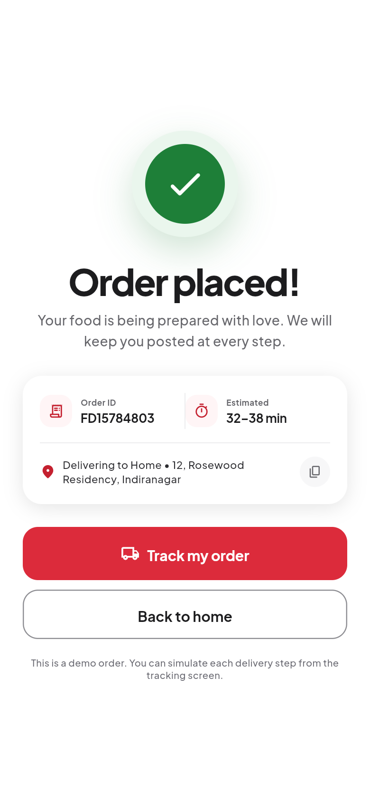</a>
      <br /><sub><b>Order placed</b></sub>
    </td>
  </tr>
</table>

### Orders &amp; tracking

<table>
  <tr>
    <td align="center" width="33%">
      <a href="docs/screenshots/tracking.png"></a>
      <br /><sub><b>Live tracking</b></sub>
    </td>
    <td align="center" width="33%">
      <a href="docs/screenshots/orders-active.png">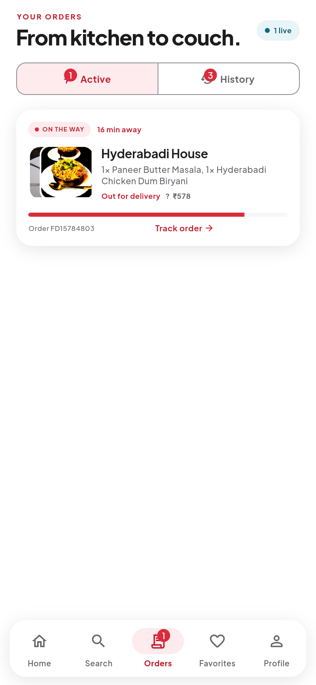</a>
      <br /><sub><b>Active orders</b></sub>
    </td>
    <td align="center" width="33%">
      <a href="docs/screenshots/order-history.png">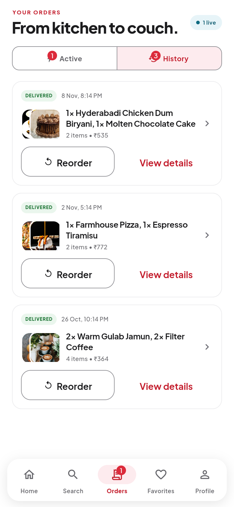</a>
      <br /><sub><b>Order history</b></sub>
    </td>
  </tr>
</table>

### Discover &amp; account

<table>
  <tr>
    <td align="center" width="33%">
      <a href="docs/screenshots/search.png">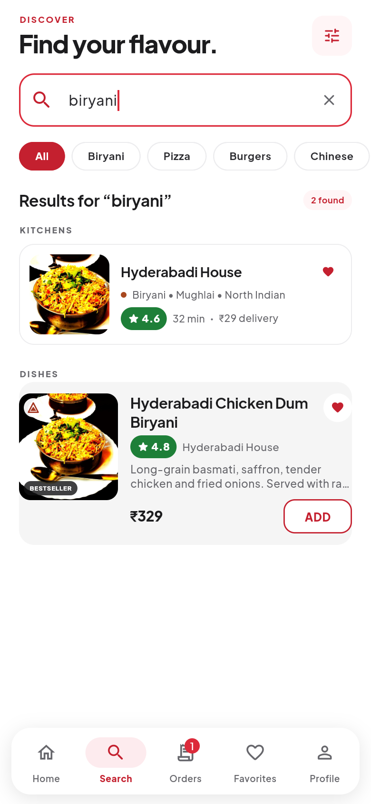</a>
      <br /><sub><b>Search</b></sub>
    </td>
    <td align="center" width="33%">
      <a href="docs/screenshots/favorites.png">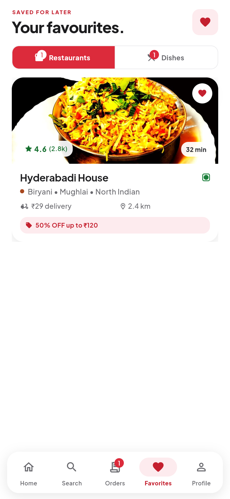</a>
      <br /><sub><b>Favorites</b></sub>
    </td>
    <td align="center" width="33%">
      <a href="docs/screenshots/profile.png">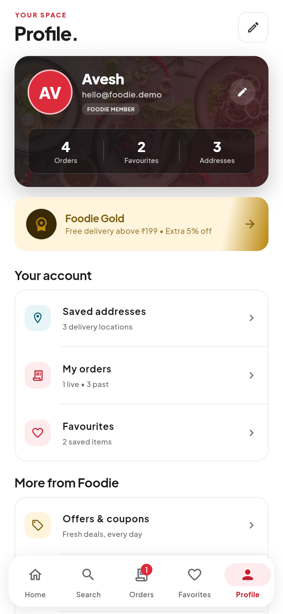</a>
      <br /><sub><b>Profile</b></sub>
    </td>
  </tr>
  <tr>
    <td align="center" width="33%">
      <a href="docs/screenshots/offers.png">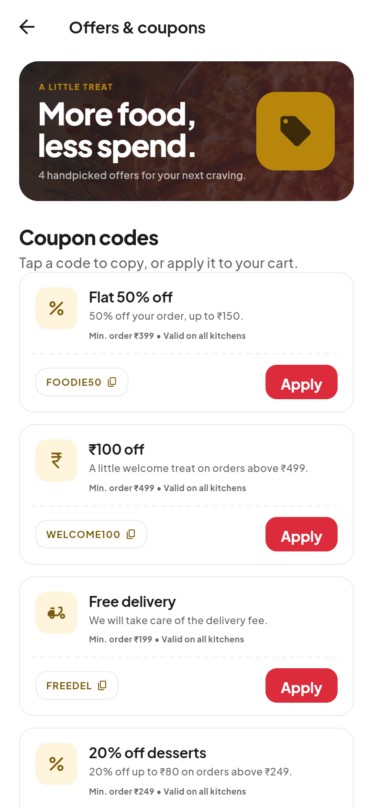</a>
      <br /><sub><b>Offers &amp; coupons</b></sub>
    </td>
    <td align="center" width="33%">
      <a href="docs/screenshots/support.png">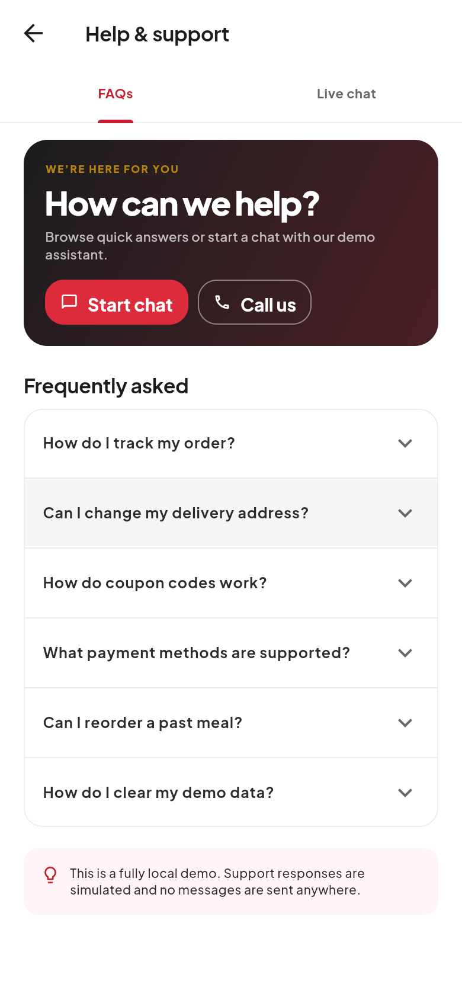</a>
      <br /><sub><b>Help &amp; support</b></sub>
    </td>
    <td align="center" width="33%">
      <a href="docs/screenshots/login.png">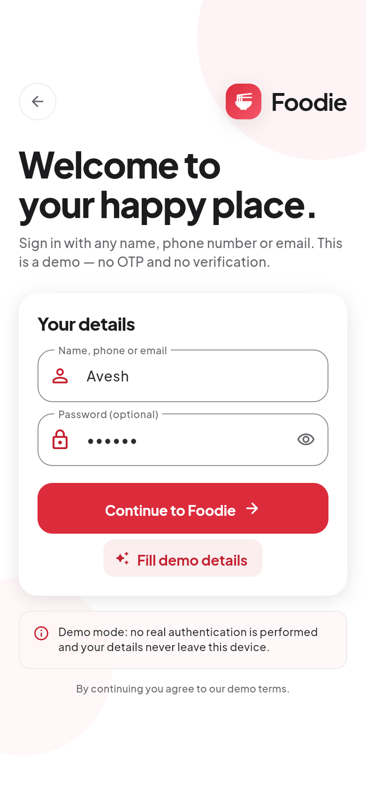</a>
      <br /><sub><b>Demo login</b></sub>
    </td>
  </tr>
</table>

### Light &amp; dark themes

<table>
  <tr>
    <td align="center" width="33%">
      <a href="docs/screenshots/settings.png">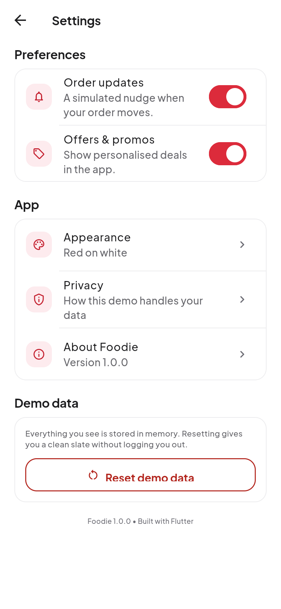</a>
      <br /><sub><b>Settings</b></sub>
    </td>
    <td align="center" width="33%">
      <a href="docs/screenshots/settings-dark.png">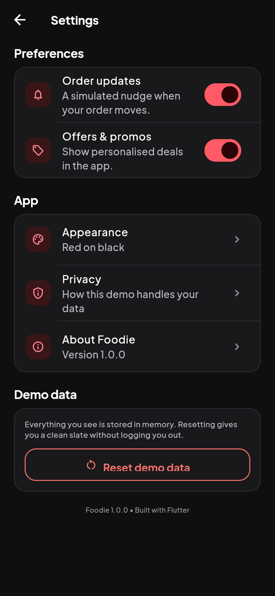</a>
      <br /><sub><b>Settings — dark</b></sub>
    </td>
    <td align="center" width="33%">
      <a href="docs/screenshots/home-dark.png">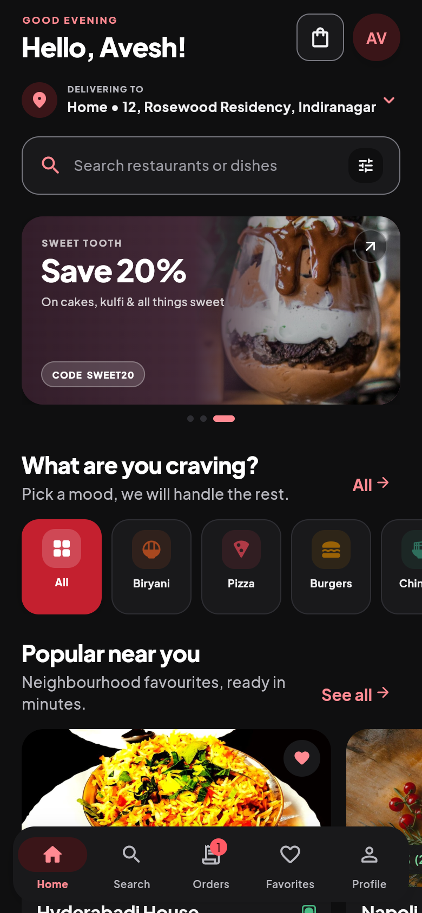</a>
      <br /><sub><b>Home — dark</b></sub>
    </td>
  </tr>
</table>

## Requirements

- Flutter **3.50.0+ stable**
- Dart **3.14.0+** (bundled with Flutter)
- Node **20+** for the API in `server/`
- Android SDK 36 + JDK 21 for Android builds
- This deliverable is an **Android phone build only**; the iOS host folder remains in the Flutter project but is not part of the APK.

Runtime packages are deliberately minimal: `http` for API calls and the SSE stream
in all three apps, plus `fl_chart` and `image_picker` in the admin and kitchen apps.
There is no state-management, routing or UI-kit dependency.

## Run the app

```bash
flutter pub get
flutter devices
flutter run
```

Run on a specific device:

```bash
flutter run -d <device-id>
```

Fast browser preview (web target included for design review):

```bash
flutter run -d chrome
```

### Android phones (split per ABI)

No universal APK and no iPhone build. Modern Android phones use the arm64 APK; older 32-bit phones use armv7.

```bash
flutter build apk --release --split-per-abi --target-platform android-arm,android-arm64
```

Outputs:

```text
build/app/outputs/flutter-apk/app-arm64-v8a-release.apk
build/app/outputs/flutter-apk/app-armeabi-v7a-release.apk
```

Ready-to-share copies are in `dist/`:

```text
dist/Foodie-arm64-v8a.apk     ? install this on almost every modern Android phone
dist/Foodie-armeabi-v7a.apk   ? for older 32-bit Android phones
```

Install with:

```bash
adb install -r dist/Foodie-arm64-v8a.apk
```

Current build fingerprints (SHA-256):

```text
Foodie-arm64-v8a.apk    159D2754AD104A5B1724D6FA9290F8B8115EA21B5478829A170F899BC7ED7AF5
Foodie-armeabi-v7a.apk  0C55F7E99ACF9B0DDA236603114E91ACDB5A885E6E7CC8AA9127195586DF48DE
```

Both APKs are release-mode, debug-signed (fine for sideloading, not for Play
Store upload) and contain a single ABI each.

## Demo login

1. Launch the app.
2. Tap **Get Started**.
3. Enter anything, for example `Avesh`, a phone number, or an email. The password is optional and accepts anything.
4. Tap **Continue to Foodie**.

The exact text you enter is used for the home greeting and profile. **Fill demo details** is a shortcut that uses “Avesh”. Log out from Profile → Log out.

## Demo coupons

| Code | Offer | Minimum |
| --- | --- | --- |
| `FOODIE50` | 50% off up to ₹150 | ₹399 |
| `WELCOME100` | ₹100 off | ₹499 |
| `FREEDEL` | Free delivery | ₹199 |
| `SWEET20` | 20% off up to ₹80 | ₹249 |

Coupons are validated and calculated locally. Try applying one that is not eligible to see the inline feedback.

## Demo orders and tracking

- Tap a restaurant → add a dish (choose add-ons and quantity) → **View cart** → apply a coupon → **Proceed to checkout** → choose payment → **Place order**.
- The order appears under **Orders → Active** and on the success screen.
- Open **Track my order**. Use **Simulate next status** to move through all six states, or enable **Auto-play status updates**.
- When the order reaches **Delivered**, it moves automatically to **Orders → History**. Open it to view details or tap **Reorder**.

Three historical sample orders are included so History is populated on first launch.

## Project structure

```text
food/
├── android/                    # Android host project (customer app)
├── ios/                        # iOS host project
├── web/                        # Flutter web host + Next.js showcase (web/showcase/)
├── admin/                      # Separate Flutter admin app
├── kitchen/                    # Separate Flutter kitchen app
├── server/                     # Hono API: Drizzle + Neon Postgres, Realtime, Storage
├── packages/foodie_core/       # Models + API client used by admin and kitchen
├── docs/                       # Screenshots, ADRs and working notes
├── tool/                       # Deterministic test runner (tool/test.ps1)
├── assets/
│   ├── brand/app_icon.png      # Source app icon artwork
│   ├── fonts/                  # Bundled Plus Jakarta Sans + Fraunces
│   └── images/                 # Bundled restaurant and dish photography
├── lib/
│   ├── main.dart               # Entry point: starts ApiSync, system UI styling
│   ├── app.dart                # MaterialApp, theme, state scope, offline gate
│   ├── data/mock_data.dart     # Seed catalogue + offline fallback, coupons, riders, FAQs
│   ├── models/                 # Food, restaurant, cart, address and order models
│   ├── screens/
│   │   ├── welcome_screen.dart
│   │   ├── login_screen.dart
│   │   ├── main_shell.dart
│   │   ├── home_screen.dart
│   │   ├── search_screen.dart
│   │   ├── restaurant_screen.dart
│   │   ├── cart_screen.dart
│   │   ├── checkout_screen.dart
│   │   ├── order_success_screen.dart
│   │   ├── order_tracking_screen.dart
│   │   ├── orders_screen.dart
│   │   ├── favorites_screen.dart
│   │   ├── profile_screen.dart
│   │   ├── addresses_screen.dart
│   │   ├── offers_screen.dart
│   │   ├── support_screen.dart
│   │   ├── settings_screen.dart
│   │   └── connection_error_screen.dart  # API unreachable: retry or use saved menu
│   ├── services/
│   │   ├── api_sync.dart       # Catalogue refresh + SSE /events subscription
│   │   └── orders_api.dart     # POST /orders at checkout
│   ├── state/
│   │   ├── foodie_app_state.dart  # Single ChangeNotifier source of truth
│   │   └── foodie_scope.dart      # InheritedNotifier access
│   ├── theme/app_theme.dart       # Global stylesheet: palette + type, light & dark
│   ├── utils/formatters.dart      # INR formatting, dates, snackbars
│   └── widgets/                   # Reusable cards, buttons, nav, sheets
├── test/
│   ├── widget_test.dart           # state and calculation tests
│   └── ui_test.dart               # cart renders, theme switch, every screen in both themes
├── pubspec.yaml
├── README.md
└── CREDITS.md
```

## State management

`FoodieAppState` is a `ChangeNotifier` exposed through `FoodieScope` (an `InheritedNotifier`). It owns the session, addresses, cart, favorites, applied coupon, payment choice, orders and settings. Screens depend on it directly, so cart badges, favorites, order status and totals update immediately throughout the app.

Server data flows through `lib/services/`:

- `ApiSync` fetches `/restaurants` and `/menu`, replaces the `MockData` catalogue and
  subscribes to `/events`; every Neon Realtime change triggers a refresh and
  `FoodieAppState` rebuilds from it.
- `OrdersApi` posts the order and its line items to `/orders` at checkout. Checkout
  still completes if that request fails.

Calculations:

- Subtotal = sum of `(item price + add-ons) × quantity`
- Delivery fee = the highest restaurant delivery fee in the cart
- Taxes = 5% of subtotal
- Discount = coupon rule applied to subtotal (or delivery fee for free-delivery coupons)
- Total = subtotal + delivery fee + taxes − discount

## Theming — one stylesheet, light and dark

The app uses **the Foodie palette**: `#E23744`-family red (`#DC2B3B` on the
fill, so white labels clear AA), white surfaces, near-black ink, a rating
green badge and an all-sans type scale. Flutter's answer to CSS custom
properties is a `ThemeExtension`: a bundle of named tokens the `Theme`
carries, so a widget asks the theme for a colour instead of hardcoding one.
`lib/theme/app_theme.dart` is that stylesheet.

It defines two extensions plus a `BuildContext` accessor:

```dart
context.foodie.surface        // card surface
context.foodie.ink            // body text
context.foodie.primary        // Foodie red (fills)
context.foodie.onPrimary      // the label colour that sits on it
context.foodie.successInk     // green as text on its tint
context.foodie.gold           // loyalty / value
context.foodie.panelDark      // dark hero panels, fixed in both themes
context.foodieType.h2         // themed type-scale entry
```

`FoodiePalette.light` and `FoodiePalette.dark` are composed independently —
the dark scheme is a red-on-black night palette, not a mechanical inversion.
`MaterialApp` maps them via `theme` / `darkTheme` / `themeMode`, so switching
brightness is one assignment rather than a second copy of every screen.

Users pick **System / Light / Dark** in **Profile → Settings → Appearance**.
The choice lives in `FoodieAppState.themeMode`.

### Colour rules the code follows

| Rule | Why |
|---|---|
| White labels sit on the fill red | white on Foodie's `#E23744` is 4.32:1, so the fill is deepened to `#DC2B3B` (4.72:1) |
| `primaryInk` for red text/icons on white | `primary` as text is only 4.7:1 against white for large type; `#C4202F` gives 5.84:1 |
| `*Ink` tokens for text on `*Soft` tints | keeps 4.5:1 on every tint |
| Red means brand/action only | "preparing" is `warning`, "delivered" is `success`, "live" is `info` |
| Rating green is a badge, never body text | white on `#1E7F38` is 5.06:1 |
| Cuisine hue means cuisine identity | sourced from `MockData.categories`, always beside a written label; the "All" tile wears brand red |
| Colour is never the only signal | every state also carries an icon and/or a label |

Every foreground/background pairing in both palettes was checked against the
WCAG 2.2 contrast formula (4.5:1 for text, 3:1 for control boundaries).

## Verification

```bash
# Customer app
flutter analyze
flutter test
flutter build apk --release --split-per-abi --target-platform android-arm,android-arm64

# Admin and kitchen apps
(cd admin && flutter analyze)
(cd kitchen && flutter analyze)

# API
cd server && npm run build
```

The API also exposes `GET /health`, which returns `{ "ok": true }` without touching
the database, for a quick check that the server is up:

```bash
curl http://localhost:3001/health
```

On Windows, `flutter test` can exit with a `PathNotFoundException` while
deleting its temp listener even after every test passed — an external cleaner
removes the folder first. `tool/test.ps1` pins `TMP`/`TEMP` to a project-local
folder and runs the same suite deterministically:

```powershell
.\tool\test.ps1
```

`flutter analyze` reports **no issues** and the test suite passes:

- calculation and state tests (cart maths, coupons, favourites, orders, addresses)
- a cart regression test — the cart must paint its lines, not an empty body
- a screen smoke test that paints **every screen in both themes** and fails on
  any layout error (this is what caught the cart overflow and two others)

## Installed design skill set

Project-scoped skills live in `.agents/skills` (lockfile: `skills-lock.json`) and cover mobile UI/UX, Flutter frontend design, visual foundations, interaction design, Android/iOS patterns and accessibility. The high-risk, API-key-dependent “Sleek” skill was deliberately removed; all remaining skills were security-reviewed by the installer.

## Limitations

- Three apps and one API share a single Neon Postgres database. Authentication is
  demo-only: `admin` / `password123` and `kitchen` / `password123` are seeded
  plaintext users, and the customer app accepts any name.
- Restaurants, menus, availability and placed orders persist in Postgres. Customer
  cart, favorites, addresses and session live in memory and reset on restart/logout.
- Payment methods are simulations and never collect real card/UPI data.
- Tracking is a designed demo, not real GPS or a maps integration.
- No push notifications: new-order alerts are in-app and, in the kitchen app, a
  local sound and vibration.
- Analytics are derived from seeded and newly placed orders, not a production event
  pipeline.

See [CREDITS.md](CREDITS.md) for photography and font attributions.
