# Foodie — Restaurant Customer App

A complete, polished Flutter restaurant ordering MVP built with Material 3, local state and realistic mock data. No backend, authentication service, payment gateway, maps API, GPS or remote images are required at runtime.

<table align="center">
  <tr>
    <td align="center" width="33%">
      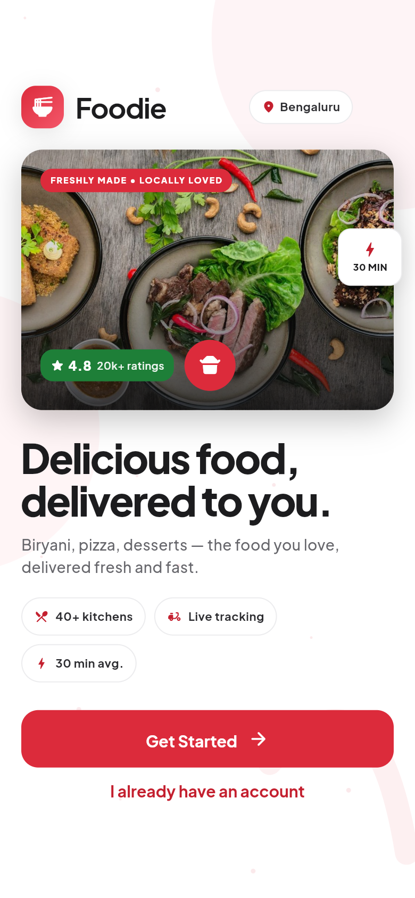
      <br /><sub><b>Welcome</b></sub>
    </td>
    <td align="center" width="33%">
      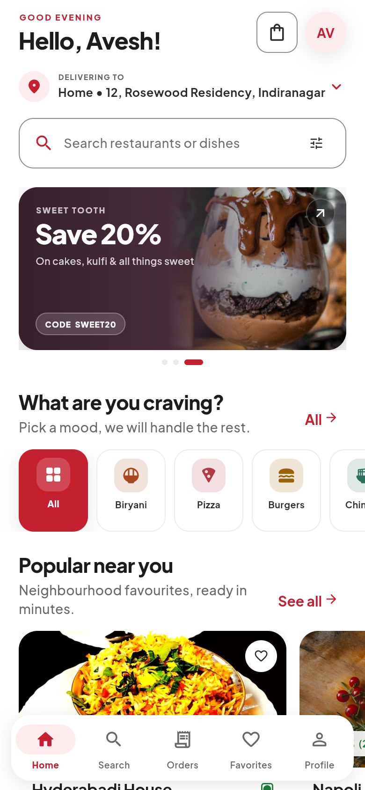
      <br /><sub><b>Home</b></sub>
    </td>
    <td align="center" width="33%">
      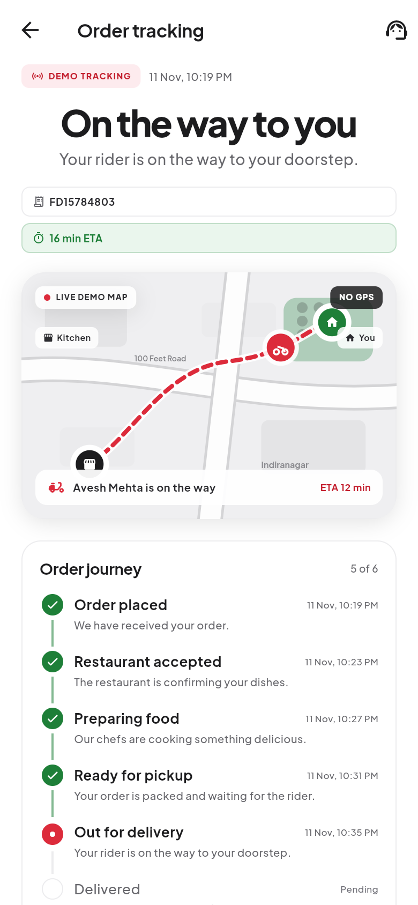
      <br /><sub><b>Live tracking</b></sub>
    </td>
  </tr>
</table>

> **Design direction:** Zomato's identity — white canvas, `#E23744`-family
> red for every action, near-black ink, green star rating badges and an
> all-sans (Plus Jakarta Sans) type scale. Rounded cards, food photography
> bundled locally, light neutral shadows, small purposeful motion. A matching
> red-on-black dark theme is one tap away in Settings.

## Highlights

- **Material 3 UI** throughout: `NavigationBar`, tablet `NavigationRail`, `SegmentedButton`, Cards, `ListTile`, chips, switches, dialogs, bottom sheets and Material buttons.
- **Splash / welcome** with animated logo, tagline and Get Started CTA.
- **Mock login** that accepts any non-empty name, phone number or email and personalises the app instantly.
- **Home** with delivery address selector, search, auto-rotating offer carousel, category filtering, popular restaurants, recommended dishes and coupon offers.
- **6 restaurants and 28 dishes** with full menus, ratings, descriptions, veg / non-veg filters and add-ons.
- **Live search** across restaurants and dishes, recent searches, category filters and empty states.
- **Favorites** for both restaurants and dishes, synchronised across every screen.
- **Cart** with quantity controls, item removal, cooking instructions, coupon validation, GST, delivery fee and a correct live bill.
- **Checkout** with saved addresses, add / edit address sheets, simulated COD / UPI / card payments and order placement.
- **Order success** with confetti, a celebratory haptic pattern and the device's system alert sound.
- **Active orders**, **order history**, **reorder** and a six-step delivery timeline with animated status changes.
- **Demo tracking** with a hand-painted neighbourhood map, animated rider marker, mock rider details and ETA.
- **Simulated status controls** — advance manually or auto-play every 6 seconds. Fully labelled as demo.
- **Profile** with editable name/contact, saved addresses, orders, favorites, offers, support, settings and logout.
- **Support** with an FAQ accordion, quick topics and a local simulated chat assistant.
- **Responsive layouts**, SafeArea support, keyboard-aware forms, accessible 44 px tap targets and graceful image fallbacks.

All activity is in memory and resets whenever the app restarts.

## Screenshots

Every screen below is captured from this build at a 390 × 844 phone viewport. The app ships with both the light Zomato-inspired theme and the red-on-black dark theme. Click any image to open it full size.

### Ordering flow

<table>
  <tr>
    <td align="center" width="33%">
      <a href="docs/screenshots/restaurant.png">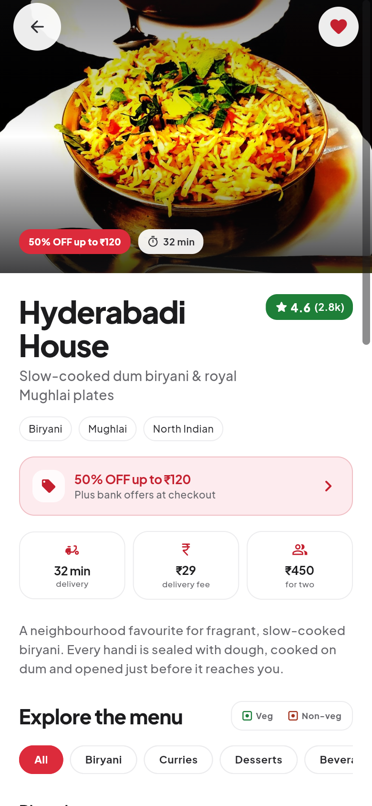</a>
      <br /><sub><b>Restaurant</b></sub>
    </td>
    <td align="center" width="33%">
      <a href="docs/screenshots/menu.png">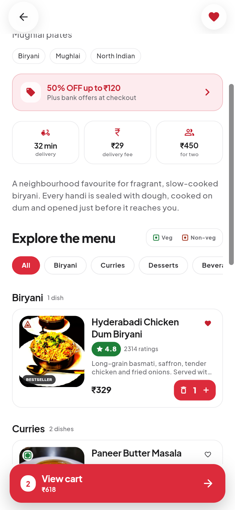</a>
      <br /><sub><b>Menu &amp; cart bar</b></sub>
    </td>
    <td align="center" width="33%">
      <a href="docs/screenshots/dish-customisation.png">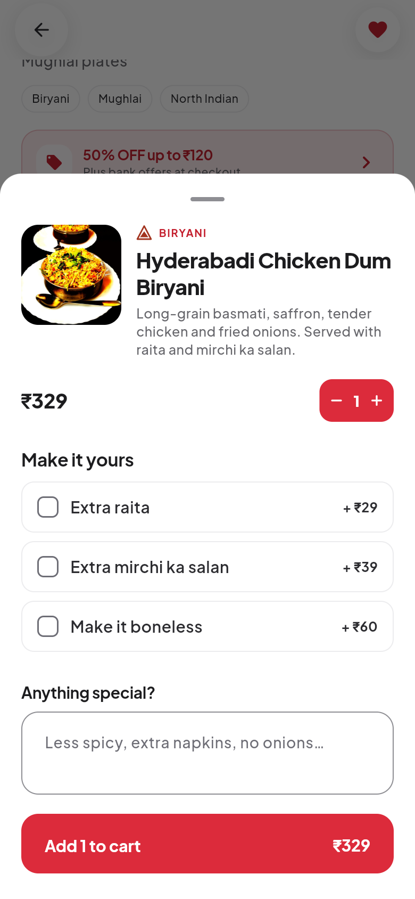</a>
      <br /><sub><b>Dish customisation</b></sub>
    </td>
  </tr>
  <tr>
    <td align="center" width="33%">
      <a href="docs/screenshots/cart.png">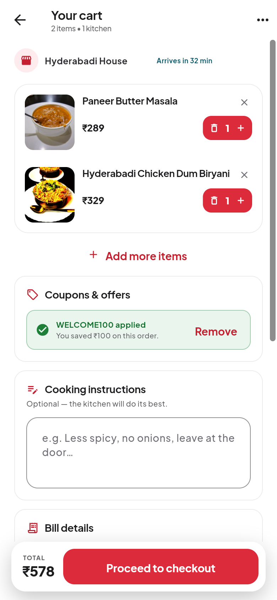</a>
      <br /><sub><b>Cart &amp; coupons</b></sub>
    </td>
    <td align="center" width="33%">
      <a href="docs/screenshots/checkout.png">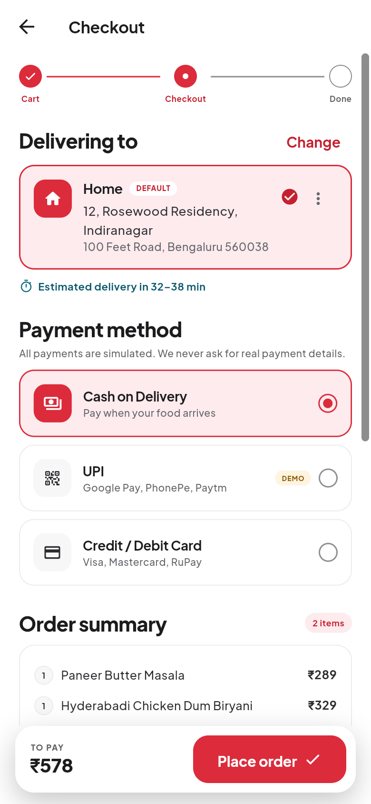</a>
      <br /><sub><b>Checkout</b></sub>
    </td>
    <td align="center" width="33%">
      <a href="docs/screenshots/order-success.png">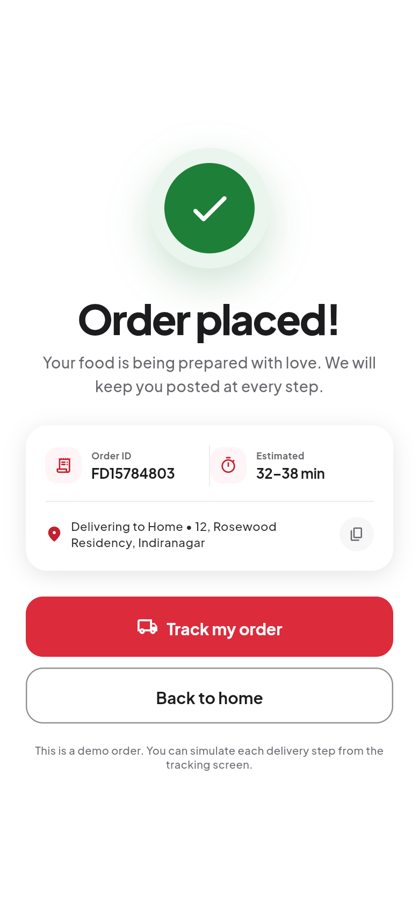</a>
      <br /><sub><b>Order placed</b></sub>
    </td>
  </tr>
</table>

### Orders &amp; tracking

<table>
  <tr>
    <td align="center" width="33%">
      <a href="docs/screenshots/tracking.png"></a>
      <br /><sub><b>Live tracking</b></sub>
    </td>
    <td align="center" width="33%">
      <a href="docs/screenshots/orders-active.png">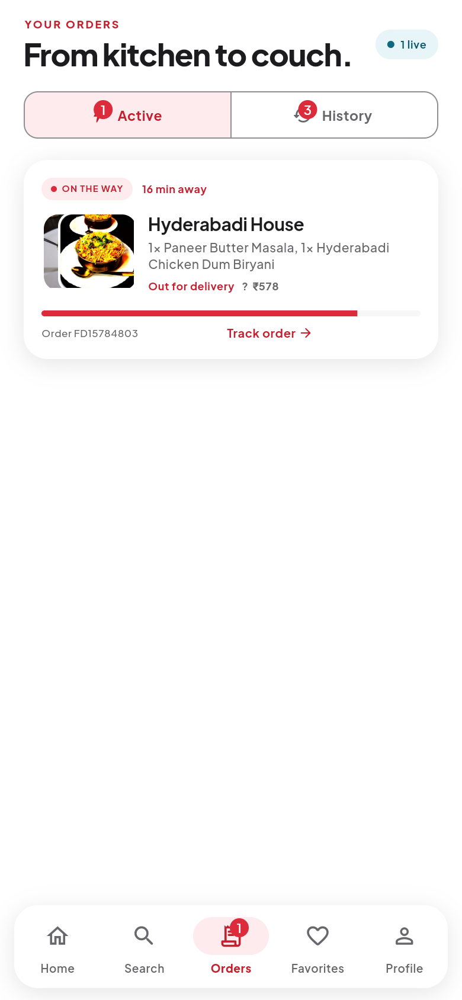</a>
      <br /><sub><b>Active orders</b></sub>
    </td>
    <td align="center" width="33%">
      <a href="docs/screenshots/order-history.png">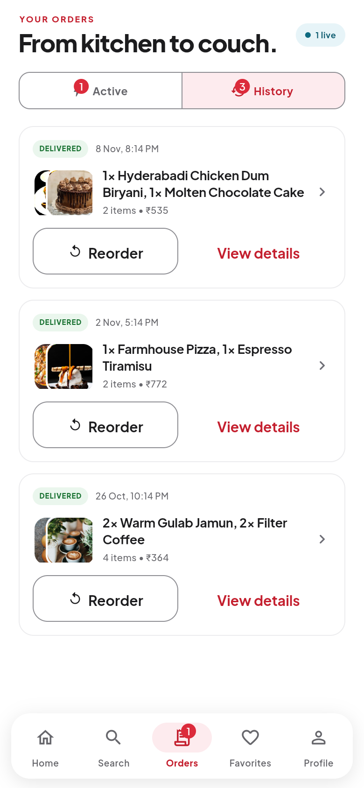</a>
      <br /><sub><b>Order history</b></sub>
    </td>
  </tr>
</table>

### Discover &amp; account

<table>
  <tr>
    <td align="center" width="33%">
      <a href="docs/screenshots/search.png">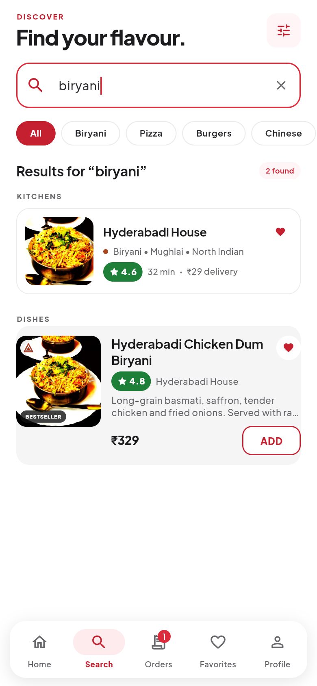</a>
      <br /><sub><b>Search</b></sub>
    </td>
    <td align="center" width="33%">
      <a href="docs/screenshots/favorites.png">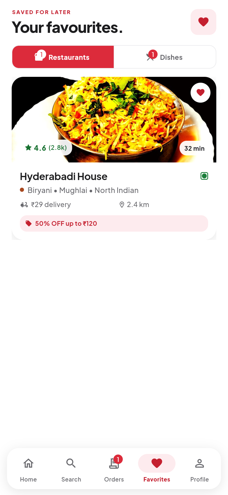</a>
      <br /><sub><b>Favorites</b></sub>
    </td>
    <td align="center" width="33%">
      <a href="docs/screenshots/profile.png">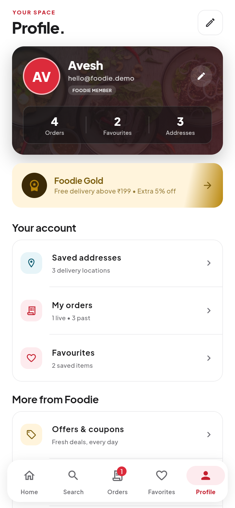</a>
      <br /><sub><b>Profile</b></sub>
    </td>
  </tr>
  <tr>
    <td align="center" width="33%">
      <a href="docs/screenshots/offers.png">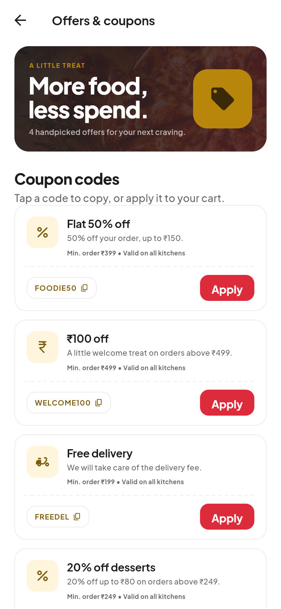</a>
      <br /><sub><b>Offers &amp; coupons</b></sub>
    </td>
    <td align="center" width="33%">
      <a href="docs/screenshots/support.png">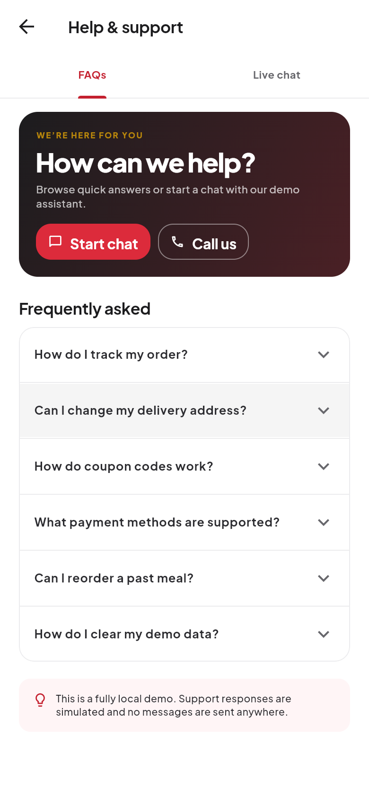</a>
      <br /><sub><b>Help &amp; support</b></sub>
    </td>
    <td align="center" width="33%">
      <a href="docs/screenshots/login.png">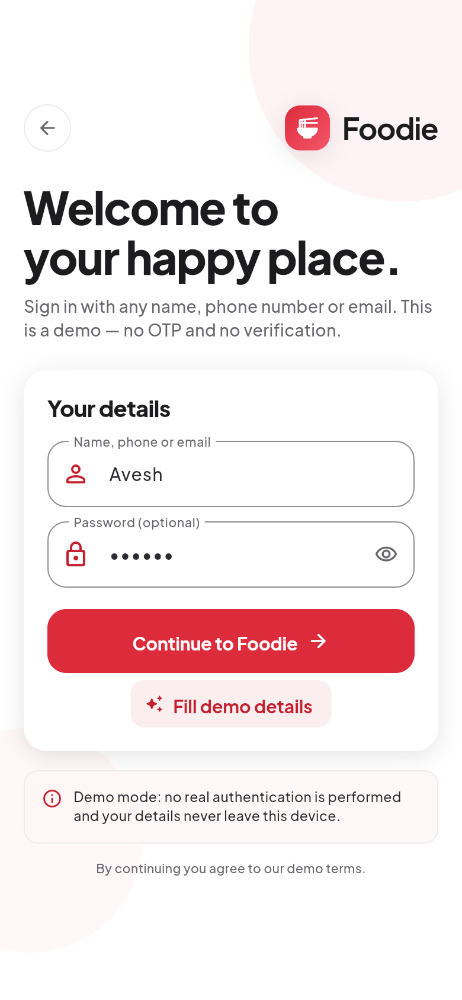</a>
      <br /><sub><b>Demo login</b></sub>
    </td>
  </tr>
</table>

### Light &amp; dark themes

<table>
  <tr>
    <td align="center" width="33%">
      <a href="docs/screenshots/settings.png">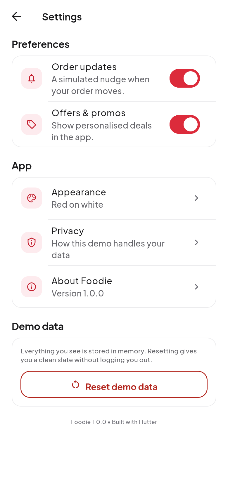</a>
      <br /><sub><b>Settings</b></sub>
    </td>
    <td align="center" width="33%">
      <a href="docs/screenshots/settings-dark.png">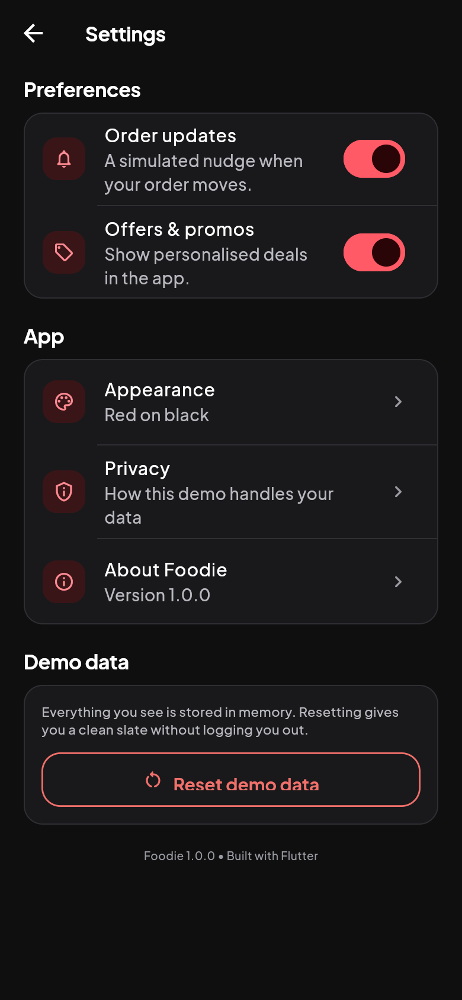</a>
      <br /><sub><b>Settings — dark</b></sub>
    </td>
    <td align="center" width="33%">
      <a href="docs/screenshots/home-dark.png">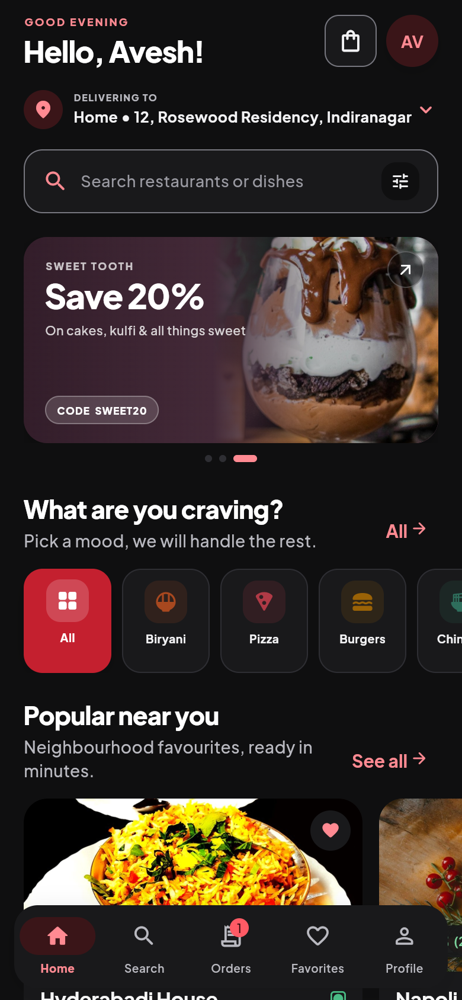</a>
      <br /><sub><b>Home — dark</b></sub>
    </td>
  </tr>
</table>

## Requirements

- Flutter **3.50.0+ stable**
- Dart **3.14.0+** (bundled with Flutter)
- Android SDK 36 + JDK 21 for Android builds
- This deliverable is an **Android phone build only**; the iOS host folder remains in the Flutter project but is not part of the APK.

The app has **no third-party runtime packages** — just Flutter and Dart.

## Run the app

```bash
flutter pub get
flutter devices
flutter run
```

Run on a specific device:

```bash
flutter run -d <device-id>
```

Fast browser preview (web target included for design review):

```bash
flutter run -d chrome
```

### Android phones (split per ABI)

No universal APK and no iPhone build. Modern Android phones use the arm64 APK; older 32-bit phones use armv7.

```bash
flutter build apk --release --split-per-abi --target-platform android-arm,android-arm64
```

Outputs:

```text
build/app/outputs/flutter-apk/app-arm64-v8a-release.apk
build/app/outputs/flutter-apk/app-armeabi-v7a-release.apk
```

Ready-to-share copies are in `dist/`:

```text
dist/Foodie-arm64-v8a.apk     ? install this on almost every modern Android phone
dist/Foodie-armeabi-v7a.apk   ? for older 32-bit Android phones
```

Install with:

```bash
adb install -r dist/Foodie-arm64-v8a.apk
```

Current build fingerprints (SHA-256):

```text
Foodie-arm64-v8a.apk    159D2754AD104A5B1724D6FA9290F8B8115EA21B5478829A170F899BC7ED7AF5
Foodie-armeabi-v7a.apk  0C55F7E99ACF9B0DDA236603114E91ACDB5A885E6E7CC8AA9127195586DF48DE
```

Both APKs are release-mode, debug-signed (fine for sideloading, not for Play
Store upload) and contain a single ABI each.

## Demo login

1. Launch the app.
2. Tap **Get Started**.
3. Enter anything, for example `Avesh`, a phone number, or an email. The password is optional and accepts anything.
4. Tap **Continue to Foodie**.

The exact text you enter is used for the home greeting and profile. **Fill demo details** is a shortcut that uses “Avesh”. Log out from Profile → Log out.

## Demo coupons

| Code | Offer | Minimum |
| --- | --- | --- |
| `FOODIE50` | 50% off up to ₹150 | ₹399 |
| `WELCOME100` | ₹100 off | ₹499 |
| `FREEDEL` | Free delivery | ₹199 |
| `SWEET20` | 20% off up to ₹80 | ₹249 |

Coupons are validated and calculated locally. Try applying one that is not eligible to see the inline feedback.

## Demo orders and tracking

- Tap a restaurant → add a dish (choose add-ons and quantity) → **View cart** → apply a coupon → **Proceed to checkout** → choose payment → **Place order**.
- The order appears under **Orders → Active** and on the success screen.
- Open **Track my order**. Use **Simulate next status** to move through all six states, or enable **Auto-play status updates**.
- When the order reaches **Delivered**, it moves automatically to **Orders → History**. Open it to view details or tap **Reorder**.

Three historical sample orders are included so History is populated on first launch.

## Project structure

```text
food/
├── android/                    # Android host project
├── ios/                        # iOS host project
├── web/                        # Browser preview target
├── docs/screenshots/           # Screenshots used in this README
├── assets/
│   ├── brand/app_icon.png      # Source app icon artwork
│   ├── fonts/                  # Bundled Plus Jakarta Sans + Fraunces
│   └── images/                 # Bundled restaurant and dish photography
├── lib/
│   ├── main.dart               # Entry point, system UI styling
│   ├── app.dart                # MaterialApp, theme, state scope
│   ├── data/mock_data.dart     # Restaurants, dishes, coupons, riders, FAQs, seed orders
│   ├── models/                 # Food, restaurant, cart, address and order models
│   ├── screens/
│   │   ├── welcome_screen.dart
│   │   ├── login_screen.dart
│   │   ├── main_shell.dart
│   │   ├── home_screen.dart
│   │   ├── search_screen.dart
│   │   ├── restaurant_screen.dart
│   │   ├── cart_screen.dart
│   │   ├── checkout_screen.dart
│   │   ├── order_success_screen.dart
│   │   ├── order_tracking_screen.dart
│   │   ├── orders_screen.dart
│   │   ├── favorites_screen.dart
│   │   ├── profile_screen.dart
│   │   ├── addresses_screen.dart
│   │   ├── offers_screen.dart
│   │   ├── support_screen.dart
│   │   └── settings_screen.dart
│   ├── state/
│   │   ├── foodie_app_state.dart  # Single ChangeNotifier source of truth
│   │   └── foodie_scope.dart      # InheritedNotifier access
│   ├── theme/app_theme.dart       # Global stylesheet: palette + type, light & dark
│   ├── utils/formatters.dart      # INR formatting, dates, snackbars
│   └── widgets/                   # Reusable cards, buttons, nav, sheets
├── test/
│   ├── widget_test.dart           # state and calculation tests
│   └── ui_test.dart               # cart renders, theme switch, every screen in both themes
├── pubspec.yaml
├── README.md
└── CREDITS.md
```

## State management

`FoodieAppState` is a `ChangeNotifier` exposed through `FoodieScope` (an `InheritedNotifier`). It owns the session, addresses, cart, favorites, applied coupon, payment choice, orders and settings. Screens depend on it directly, so cart badges, favorites, order status and totals update immediately throughout the app.

Calculations:

- Subtotal = sum of `(item price + add-ons) × quantity`
- Delivery fee = the highest restaurant delivery fee in the cart
- Taxes = 5% of subtotal
- Discount = coupon rule applied to subtotal (or delivery fee for free-delivery coupons)
- Total = subtotal + delivery fee + taxes − discount

## Theming — one stylesheet, light and dark

The app wears **Zomato's identity**: `#E23744`-family red (`#DC2B3B` on the
fill, so white labels clear AA), white surfaces, near-black ink, a rating
green badge and an all-sans type scale. Flutter's answer to CSS custom
properties is a `ThemeExtension`: a bundle of named tokens the `Theme`
carries, so a widget asks the theme for a colour instead of hardcoding one.
`lib/theme/app_theme.dart` is that stylesheet.

It defines two extensions plus a `BuildContext` accessor:

```dart
context.foodie.surface        // card surface
context.foodie.ink            // body text
context.foodie.primary        // Zomato red (fills)
context.foodie.onPrimary      // the label colour that sits on it
context.foodie.successInk     // green as text on its tint
context.foodie.gold           // loyalty / value
context.foodie.panelDark      // dark hero panels, fixed in both themes
context.foodieType.h2         // themed type-scale entry
```

`FoodiePalette.light` and `FoodiePalette.dark` are composed independently —
the dark scheme is a red-on-black night palette, not a mechanical inversion.
`MaterialApp` maps them via `theme` / `darkTheme` / `themeMode`, so switching
brightness is one assignment rather than a second copy of every screen.

Users pick **System / Light / Dark** in **Profile → Settings → Appearance**.
The choice lives in `FoodieAppState.themeMode`.

### Colour rules the code follows

| Rule | Why |
|---|---|
| White labels sit on the fill red | white on Zomato's `#E23744` is 4.32:1, so the fill is deepened to `#DC2B3B` (4.72:1) |
| `primaryInk` for red text/icons on white | `primary` as text is only 4.7:1 against white for large type; `#C4202F` gives 5.84:1 |
| `*Ink` tokens for text on `*Soft` tints | keeps 4.5:1 on every tint |
| Red means brand/action only | "preparing" is `warning`, "delivered" is `success`, "live" is `info` |
| Rating green is a badge, never body text | white on `#1E7F38` is 5.06:1 |
| Cuisine hue means cuisine identity | sourced from `MockData.categories`, always beside a written label; the "All" tile wears brand red |
| Colour is never the only signal | every state also carries an icon and/or a label |

Every foreground/background pairing in both palettes was checked against the
WCAG 2.2 contrast formula (4.5:1 for text, 3:1 for control boundaries).

## Verification

```bash
flutter analyze
flutter test
flutter build apk --release --split-per-abi --target-platform android-arm,android-arm64
```

On Windows, `flutter test` can exit with a `PathNotFoundException` while
deleting its temp listener even after every test passed — an external cleaner
removes the folder first. `tool/test.ps1` pins `TMP`/`TEMP` to a project-local
folder and runs the same suite deterministically:

```powershell
.\tool\test.ps1
```

`flutter analyze` reports **no issues** and the test suite passes:

- calculation and state tests (cart maths, coupons, favourites, orders, addresses)
- a cart regression test — the cart must paint its lines, not an empty body
- a screen smoke test that paints **every screen in both themes** and fails on
  any layout error (this is what caught the cart overflow and two others)

## Installed design skill set

Project-scoped skills live in `.agents/skills` (lockfile: `skills-lock.json`) and cover mobile UI/UX, Flutter frontend design, visual foundations, interaction design, Android/iOS patterns and accessibility. The high-risk, API-key-dependent “Sleek” skill was deliberately removed; all remaining skills were security-reviewed by the installer.

## Limitations

- Customer app only — no admin, restaurant staff or rider apps.
- No persistence: everything resets on app restart or logout.
- Payment methods are simulations and never collect real card/UPI data.
- Tracking is a designed demo, not real GPS or a maps integration.
- No push notifications, backend, analytics or external APIs.

See [CREDITS.md](CREDITS.md) for photography and font attributions.
